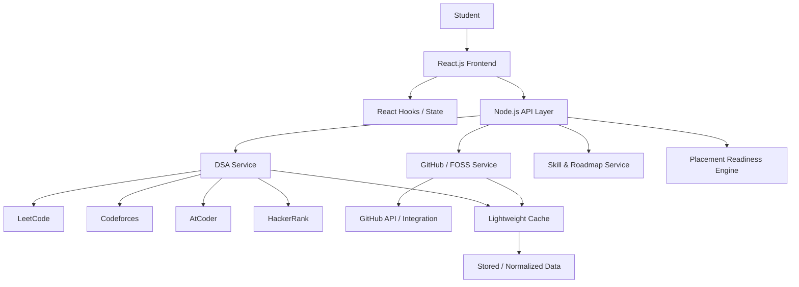
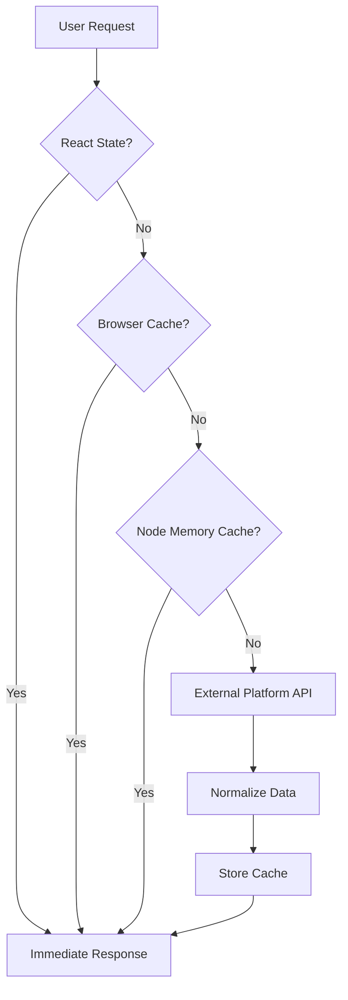
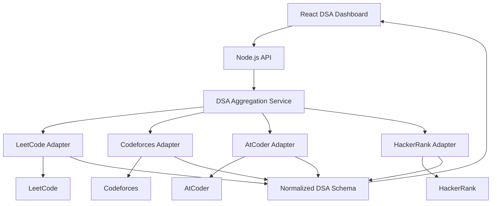
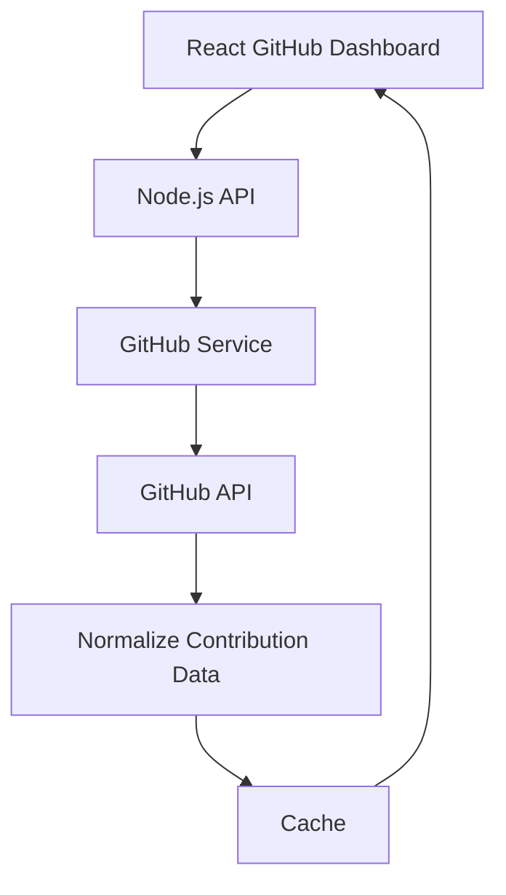
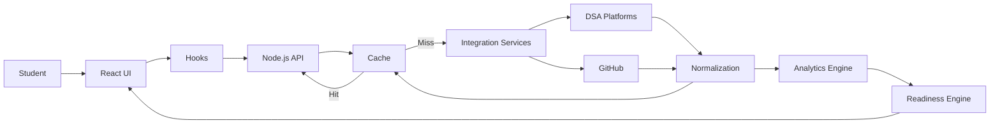
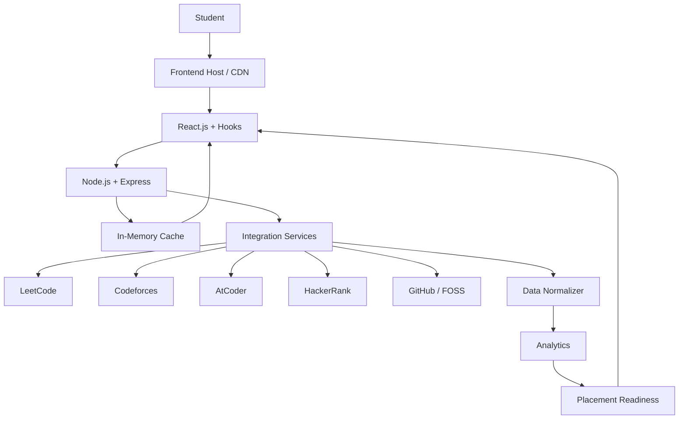

# Placement Preparation & Developer Portfolio Platform
## Final Implementation Plan — Topic 7: Placement Preparation Dashboard

> **Project basis:** Topic 7 from the supplied *Lab Based Mini Projects 2026 – Full Stack Development II* sheet.
>
> **Required technologies:** Computer, VS Code, Node.js, React.js, React Hooks.
>
> **Required project objective:** Develop dashboard components with progress tracking and conditional rendering.
>
> **Target outcome:** Build a component-based dashboard.
>
> Source: supplied project sheet, Topic 7. Page 1, lines 57–66.

---

# 1. Executive Summary

The project will be implemented as a developer-focused **Placement Preparation Dashboard** rather than a generic attendance-style dashboard.

The system will answer a central question:

> **“How prepared is a student for software-development placements, and what evidence supports that assessment?”**

The platform will combine four major areas:

1. **DSA Preparation**
   - LeetCode
   - Codeforces
   - AtCoder
   - HackerRank
   - Problem tracking
   - Topics and sheets
   - Difficulty distribution
   - Contest/rating statistics
   - Revision tracking
   - DSA analytics

2. **Web Development**
   - Frontend roadmap
   - Backend roadmap
   - Database concepts
   - Tools/DevOps concepts
   - Skill milestones
   - Projects
   - Practical evidence

3. **System Design**
   - Networking
   - Scalability
   - Caching
   - CDNs
   - Load balancing
   - Databases
   - Distributed systems
   - HLD
   - LLD
   - Design patterns
   - Case studies

4. **GitHub & FOSS / Developer Contributions**
   - GitHub profile
   - Repositories
   - Commits
   - Pull requests
   - Issues
   - Code reviews
   - Open-source contributions
   - FOSS projects
   - Collaboration evidence

These feed into an overall:

> **Placement Readiness Score**

The DSA section will take **structural inspiration from Codolio**, while the visual language will take inspiration from the user's previously created **CP Companion** project. The implementation will not copy either product's UI or proprietary implementation.

---

# 2. Project Constraints and Technical Scope

## 2.1 Official assignment constraints

The supplied project sheet specifies Topic 7 as:

- **Title:** Placement Preparation Dashboard
- **Domain:** Education
- **Description:** Dashboard for tracking student preparation for placement activities
- **Hardware/Software:** Computer, VS Code, Node.js
- **Technology:** React.js, Hooks
- **Objective:** Develop dashboard components with progress tracking and conditional rendering
- **Targeted outcome:** Students will be able to design component-based dashboards

Therefore, the core implementation must visibly demonstrate:

- React components
- React Hooks
- State management
- Progress tracking
- Conditional rendering
- Component-based dashboard design

The project should not become dependent on a heavy enterprise stack merely to satisfy the architecture.

---

# 3. Product Vision

## Working product concept

A unified platform for tracking:

```text
                    PLACEMENT PREPARATION
                            |
        +-------------------+-------------------+
        |                   |                   |
        v                   v                   v
       DSA             WEB DEVELOPMENT     SYSTEM DESIGN
        |                   |                   |
        |                   |                   |
  Coding Platforms      Skill Roadmap      HLD / LLD
  Problems              Projects           Distributed Systems
  Sheets                Milestones         Networking
  Contests              Evidence           Databases
        |
        v
 GitHub / FOSS / Developer Contributions
        |
        +-----------------------+
                                |
                                v
                    PLACEMENT READINESS
```

The dashboard should be designed to feel like a real developer product rather than a basic academic CRUD application.

---

# 4. Design Direction

## 4.1 Visual inspiration

### CP Companion

The user's previous website:

**CP Companion:**  
https://cpcompanion.vercel.app/#architecture

Use it as inspiration for:

- Dark developer-oriented visual language
- Compact information-dense layouts
- Technical/developer aesthetic
- Cards
- Navigation
- Charts
- Section hierarchy
- Responsive behavior
- Developer-oriented typography and spacing

Do **not** copy the exact interface, branding, assets, or source code.

### Codolio

Use Codolio as inspiration primarily for the **DSA information architecture**:

- Unified coding-platform tracking
- Problem/workspace organization
- Sheets
- Topic-wise progress
- Difficulty breakdown
- Contest statistics
- Platform aggregation
- Analytics

The goal is:

> **Codolio-inspired DSA architecture + CP Companion-inspired visual direction + our own placement-preparation product.**

---

# 5. Final Information Architecture

```text
PLACEMENT PREPARATION PLATFORM
|
+-- Dashboard
|
+-- DSA
|   |
|   +-- Overview
|   +-- My Problems
|   +-- Platforms
|   |   +-- LeetCode
|   |   +-- Codeforces
|   |   +-- AtCoder
|   |   +-- HackerRank
|   |
|   +-- Sheets / Roadmaps
|   +-- Topics
|   +-- Contests
|   +-- Analytics
|   +-- Revision
|
+-- Web Development
|   |
|   +-- Overview
|   +-- Frontend
|   +-- Backend
|   +-- Databases
|   +-- Tools / DevOps
|   +-- Projects
|   +-- Skill Milestones
|
+-- System Design
|   |
|   +-- Overview
|   +-- Networking
|   +-- Scalability
|   +-- Caching
|   +-- CDN
|   +-- Load Balancing
|   +-- Databases
|   +-- Distributed Systems
|   +-- HLD
|   +-- LLD
|   +-- Case Studies
|
+-- GitHub & FOSS
|   |
|   +-- GitHub Overview
|   +-- Contributions
|   +-- Pull Requests
|   +-- Issues
|   +-- Reviews
|   +-- Repositories
|   +-- Open Source / FOSS
|
+-- Projects
|
+-- Placement Readiness
|
+-- Profile / Settings
```

---

# 6. High-Level System Architecture

The implementation should remain centered on **React.js + Hooks + Node.js**.



The architecture intentionally avoids making MongoDB, Redis, Kubernetes, microservices, etc. mandatory for the first implementation.

---

# 7. Recommended Runtime Architecture

## Actual project

```text
                   Browser
                      |
                      v
              React.js + Vite
                      |
              React Hooks / State
                      |
                 HTTP / fetch
                      |
                      v
              Node.js + Express
                      |
        +-------------+-------------+
        |             |             |
        v             v             v
    DSA APIs      GitHub API    Local Progress
        |                           |
   +----+----+                      |
   |    |    |                      |
  LC   CF   AC   HR                 |
                                    v
                              localStorage /
                              IndexedDB
```

The exact backend hosting provider can be chosen after the MVP works.

---

# 8. Performance Strategy

The goal is an **incredibly fast UI** without violating the assignment's technology constraints.

## 8.1 Performance principles

1. Render the dashboard shell immediately.
2. Lazy-load large modules.
3. Fetch DSA platform data concurrently.
4. Cache frequently used data.
5. Avoid fetching external APIs on every page navigation.
6. Use stale-while-revalidate behavior.
7. Pre-compute expensive analytics.
8. Keep React components small.
9. Avoid unnecessary global state.
10. Keep the first JavaScript bundle small.

---

# 9. Lightweight Cache Architecture

A heavy Redis setup is not required initially.

## Level 1 — React state

Fastest during the active browser session.

```text
API response
     |
     v
useState()
     |
     v
React components
```

## Level 2 — Browser persistent cache

Use:

- `localStorage` for simple statistics
- IndexedDB if larger structured datasets become necessary

```text
React
  |
  +--> useState()
  |
  +--> localStorage / IndexedDB
```

## Level 3 — Node.js in-memory cache

The Node server can keep frequently requested external data in memory.

```text
Node.js
   |
   v
LRU / Map cache
   |
   v
External API
```

## Optional Level 4 — SQLite

SQLite can be introduced if the backend is deployed as a long-lived Node process/container.

Important:

> SQLite is an embedded database, not inherently a distributed cache.

It can be used as a lightweight local materialized/cache store.

For a serverless deployment, local SQLite should not be treated as the authoritative shared database because different serverless instances may not share the same filesystem.

---

# 10. Fast Request Path



This makes the common case extremely fast.

---

# 11. Stale-While-Revalidate

For platform statistics, real-time data is generally unnecessary.

Example:

```text
Cached Codeforces data
       |
       +-- Fresh?
       |      |
       |      +--> Return immediately
       |
       +-- Stale?
              |
              +--> Return cached data immediately
              |
              +--> Refresh in background
```

UI:

```text
Codeforces Rating: 1427

Last synchronized: 18 min ago
Refreshing...
```

This avoids making the student wait for external services.

---

# 12. Parallel API Requests

Never fetch platforms sequentially.

Avoid:

```js
await getLeetCode();
await getCodeforces();
await getAtCoder();
await getHackerRank();
```

Prefer:

```js
await Promise.all([
  getLeetCode(),
  getCodeforces(),
  getAtCoder(),
  getHackerRank()
]);
```

This allows independent requests to execute concurrently.

---

# 13. DSA Module — Detailed Design

The DSA module is the most API-heavy component.

```text
DSA
|
+-- Overview
|
+-- Platform Statistics
|   +-- LeetCode
|   +-- Codeforces
|   +-- AtCoder
|   +-- HackerRank
|
+-- Problem Tracker
|
+-- Sheets
|
+-- Topics
|
+-- Contests
|
+-- Revision
|
+-- Analytics
```

---

# 14. DSA Overview Screen

Suggested UI:

```text
+------------------------------------------------------------+
| DSA Preparation                                            |
| Track your coding progress across platforms                |
+------------------------------------------------------------+
|                                                            |
| Total Solved     Easy       Medium       Hard              |
|    842            310         420         112              |
|                                                            |
+------------------------------------------------------------+
| Platform Progress                                          |
|                                                            |
| LeetCode      482 solved       Rating 1680                |
| ███████████████████░░                                     |
|                                                            |
| Codeforces    326 solved       Rating 1427                |
| ███████████████░░░░░                                      |
|                                                            |
| AtCoder       310 solved       Rating 1184                |
| ████████████░░░░░░░                                       |
|                                                            |
| HackerRank    215 solved       Score ...                  |
| ██████████░░░░░░░░                                       |
|                                                            |
+------------------------------------------------------------+
| Topic Progress                                             |
|                                                            |
| Arrays            ██████████████████░░ 90%                |
| Strings           ███████████████░░░░░ 75%                |
| Binary Search     ████████████░░░░░░░ 60%                |
| Trees             ██████████░░░░░░░░░ 50%                |
| Graphs            ███████░░░░░░░░░░░ 35%                |
| DP                █████░░░░░░░░░░░░░ 25%                |
+------------------------------------------------------------+
```

---

# 15. Platform Integration Architecture

Do not make the React frontend directly dependent on every platform's API.

Use an adapter pattern.



Advantages:

- Platform-specific logic is isolated.
- API changes affect one adapter rather than the whole frontend.
- React receives a consistent data structure.
- New platforms can be added later.

---

# 16. Normalized Platform Schema

Example:

```js
{
  platform: "codeforces",
  username: "student_handle",
  problemsSolved: 326,
  rating: 1427,
  maxRating: 1512,
  rank: "specialist",
  contests: 18,
  lastUpdated: "2026-09-15T14:00:00Z"
}
```

LeetCode:

```js
{
  platform: "leetcode",
  username: "student_handle",
  problemsSolved: 482,
  easy: 210,
  medium: 230,
  hard: 42,
  contestRating: 1680,
  lastUpdated: "2026-09-15T14:00:00Z"
}
```

The exact fields should be implemented only where the platform integration reliably provides them.

---

# 17. API Availability Caveat

The architecture must not assume every platform offers the same type of public API.

## Codeforces

Codeforces provides documented API methods for user information, ratings and submissions.

## LeetCode

LeetCode's API situation differs from Codeforces and may involve GraphQL/internal/community integrations depending on the desired data.

## AtCoder

AtCoder data access should be implemented through an appropriate public/authorized integration rather than assuming an official API with the same structure as Codeforces.

## HackerRank

HackerRank's official API ecosystem is largely oriented toward HackerRank for Work functionality. A simple public competitive-programming profile API should not be assumed.

Therefore:

```text
Platform Adapter
      |
      +-- Official API if available
      |
      +-- Authorized integration
      |
      +-- Safe/manual fallback where required
```

The product should clearly label the synchronization source and timestamp.

Never scrape aggressively or bypass platform restrictions.

---

# 18. Problem Tracker

The problem tracker should be the central DSA workspace.

```text
+----------------------------------------------------------------+
| My Problems                                                    |
+----------------------------------------------------------------+
| Search: [ Binary Search________________________ ]              |
|                                                                |
| Platform   Topic       Difficulty      Status       Revision   |
|                                                                |
| LeetCode   Array       Easy             Solved       Due        |
| LeetCode   Search      Easy             Solved       Done       |
| CF         DP          Medium           Solved       Due        |
| AtCoder    String      Hard             Unsolved     -          |
+----------------------------------------------------------------+
```

Each problem can store:

- Platform
- Problem title
- Problem URL
- Topic
- Difficulty
- Status
- Date solved
- Notes
- Tags
- Revision status
- Revision date
- Importance

---

# 19. Avoiding Double Counting

This is an important system-design feature.

A student might solve the same conceptual problem on multiple platforms.

Therefore distinguish:

```text
Platform Solves
      !=
Unique Problems
```

Suggested conceptual structure:

```text
Canonical Problem
|
+-- LeetCode mapping
+-- HackerRank mapping
+-- Other platform mapping
```

The analytics layer can then report:

- Total platform solves
- Unique tracked problems
- Platform-specific activity

Do not claim exact duplicate detection unless a reliable mapping exists.

---

# 20. DSA Sheets / Roadmaps

Inspired by the sheet-based organization used by platforms such as Codolio.

Example:

```text
DSA ROADMAP
|
+-- Foundation
|   +-- Arrays
|   +-- Strings
|   +-- Sorting
|   +-- Searching
|
+-- Data Structures
|   +-- Linked List
|   +-- Stack
|   +-- Queue
|   +-- Trees
|   +-- Heap
|   +-- Hashing
|
+-- Advanced
|   +-- Graphs
|   +-- Greedy
|   +-- Backtracking
|   +-- Dynamic Programming
|   +-- Trie
|
+-- Competitive Programming
    +-- Number Theory
    +-- Bit Manipulation
    +-- Segment Tree
    +-- DSU
```

---

# 21. Revision System

Each problem should have a revision lifecycle:

```text
Solved
  |
  v
Review in 3 days
  |
  v
Review in 7 days
  |
  v
Review in 30 days
  |
  v
Mastered
```

This can initially be implemented entirely with React state + localStorage.

---

# 22. DSA Analytics

## Difficulty distribution

```text
Easy        ███████████████████ 310
Medium      █████████████████████████ 420
Hard        ███████ 112
```

## Topic distribution

```text
Arrays              120
Strings              82
Linked List          51
Trees                93
Graphs               45
Dynamic Programming  32
Greedy               41
Binary Search        38
Stack / Queue        67
Others              ...
```

## Platform distribution

```text
LeetCode       482
Codeforces     326
AtCoder        310
HackerRank     215
```

These charts should be computed from normalized data rather than manually maintained numbers.

---

# 23. Web Development Module

The Web Development module should be a **roadmap + evidence tracker**, not merely a progress bar.

```text
WEB DEVELOPMENT
|
+-- Frontend
|   +-- HTML
|   +-- CSS
|   +-- JavaScript
|   +-- React
|   +-- TypeScript
|
+-- Backend
|   +-- Node.js
|   +-- Express
|   +-- REST APIs
|   +-- Authentication
|
+-- Database
|   +-- SQL
|   +-- MongoDB
|   +-- Indexing
|
+-- Tools
|   +-- Git
|   +-- GitHub
|   +-- Docker
|
+-- Projects
```

---

# 24. Web Development Skill Tracking

Example:

```text
React

[x] Components
[x] Props
[x] State
[x] Hooks
[x] Router
[ ] Context API
[ ] Performance
[ ] Testing

Progress: 5 / 8
```

The progress is calculated:

```text
completed milestones / total milestones
```

This is more meaningful than manually setting "React = 70%".

---

# 25. Project Evidence

A student can associate a GitHub repository with a project.

Example:

```text
Project: E-Commerce Platform

Technologies:
React
Node.js
Express
MongoDB

Repository:
github.com/...

Evidence:
- Commits
- Contributors
- Pull Requests
- Issues
- Last activity
```

The platform should treat this as **supporting evidence**, not an automatic proof of skill.

---

# 26. System Design Module

```text
SYSTEM DESIGN
|
+-- Fundamentals
|
+-- Networking
|   +-- HTTP/HTTPS
|   +-- DNS
|   +-- WebSockets
|
+-- Scalability
|   +-- Load Balancing
|   +-- CDN
|   +-- Caching
|
+-- Databases
|   +-- SQL
|   +-- NoSQL
|   +-- Indexing
|   +-- Sharding
|
+-- Distributed Systems
|   +-- Replication
|   +-- Partitioning
|   +-- Consistency
|   +-- Fault Tolerance
|
+-- HLD
|
+-- LLD
|   +-- OOP
|   +-- SOLID
|   +-- Design Patterns
|
+-- Case Studies
```

---

# 27. System Design Progress

Example:

```text
Fundamentals       ███████████████░░░░░ 75%
Networking         ████████████░░░░░░░░ 60%
Databases          ████████████░░░░░░░░ 60%
Distributed Sys.   ████████░░░░░░░░░░░░ 40%
HLD                ███████████░░░░░░░░░ 55%
LLD                ██████░░░░░░░░░░░░░░ 30%
```

Each percentage comes from completed learning milestones/case studies.

---

# 28. Load Balancing and CDN in the Project

These concepts belong in the System Design learning section.

They do not have to become mandatory infrastructure for the student project.

Conceptual architecture:

```text
                   USERS
                     |
                     v
                    CDN
                     |
              +------+------+
              |             |
          Static         Dynamic
          Assets          API
              |             |
              v             v
          Frontend      Load Balancer
                            |
                  +---------+---------+
                  |         |         |
                  v         v         v
                Node 1    Node 2    Node 3
```

Explain:

- CDN reduces delivery latency for static content.
- Load balancer distributes dynamic traffic.
- Multiple backend instances allow horizontal scaling.

For the college implementation, use a simpler deployment and document this as the scalability architecture.

---

# 29. GitHub & FOSS Module

This should be a first-class module.

```text
GITHUB & FOSS
|
+-- Profile
|
+-- Activity
|   +-- Commits
|   +-- Pull Requests
|   +-- Issues
|   +-- Reviews
|
+-- Repositories
|
+-- Collaboration
|
+-- Open Source
|   +-- Contributions
|   +-- Merged PRs
|   +-- Issues
|   +-- Organizations
|
+-- Developer Contribution Score
```

---

# 30. GitHub Contribution Dashboard

Example:

```text
+------------------------------------------------------+
| GITHUB / FOSS CONTRIBUTIONS                          |
+------------------------------------------------------+
|                                                      |
| Repositories          24                             |
| Commits               412                            |
| Pull Requests          16                            |
| Merged PRs             11                            |
| Issues                  9                            |
| Code Reviews            8                            |
|                                                      |
+------------------------------------------------------+
| Open Source Projects                                 |
|                                                      |
| Project A        5 PRs       4 merged               |
| Project B        3 PRs       2 merged               |
| Project C        2 PRs       2 merged               |
+------------------------------------------------------+
```

Actual fields should depend on what the GitHub integration can reliably retrieve.

---

# 31. Do Not Equate Popularity With Skill

Avoid a simplistic metric such as:

```text
100 GitHub stars = +10 skill
```

Instead, use contribution evidence.

### Stronger signals

- Merged pull requests
- Meaningful issue participation
- Code reviews
- Contributions to established projects
- Collaboration
- Consistent activity
- Releases / project ownership

### Supporting signals

- Commits
- Repository count
- Stars
- Forks
- Followers

The system should present these as **signals**, not definitive proof of ability.

---

# 32. GitHub API Architecture



Do not expose private credentials or tokens in the React frontend.

If authenticated GitHub access is added later:

```text
Browser
   |
   v
Node.js
   |
   v
GitHub OAuth / token handling
   |
   v
GitHub API
```

---

# 33. FOSS Contribution Classification

The system can conceptually classify activity:

```text
GitHub Activity
      |
      +-- Personal
      |
      +-- Academic
      |
      +-- Team
      |
      +-- Open Source / FOSS
```

The classification must be transparent and conservative.

The system should not pretend it can perfectly infer whether every repository is "FOSS" solely from a repository name.

Use available repository metadata such as:

- Public visibility
- License metadata
- Organization
- Repository information
- Contribution relationship

---

# 34. Placement Readiness Engine

The three technical preparation areas feed into a combined score.

Initial conceptual model:

```text
DSA                  35%
Web Development      25%
System Design        20%
Projects             10%
Developer Activity   10%
```

Within Developer Activity:

```text
GitHub Activity        40%
Open Source            40%
Collaboration          20%
```

These weights should eventually be configurable.

The score should be presented as an **indicator**, not an objective measurement of employability.

---

# 35. Readiness Visualization

```text
                PLACEMENT READINESS

                         72%

        █████████████████████░░░░░░░

DSA                 81%
Web Development     67%
System Design       54%
Projects            70%
Developer Activity  63%
```

Conditional rendering:

```text
>= 85%   -> Highly Prepared
70-84%   -> Strong Preparation
50-69%   -> Keep Preparing
< 50%    -> Needs Significant Preparation
```

These labels are product logic and can be changed later.

---

# 36. "Weak Area" Engine

Instead of only showing a score:

```text
Overall: 72%
```

show:

```text
Your strongest area:
DSA

Your biggest improvement opportunity:
System Design

Suggested next actions:
1. Complete Load Balancing
2. Study CDN architecture
3. Solve 5 graph problems
4. Complete one HLD case study
```

This turns the dashboard into an actionable preparation tool.

---

# 37. React Component Architecture

```text
src/
|
+-- components/
|   +-- Navbar.jsx
|   +-- Sidebar.jsx
|   +-- ProgressCard.jsx
|   +-- PlatformCard.jsx
|   +-- SkillCard.jsx
|   +-- ActivityCard.jsx
|   +-- ContributionCard.jsx
|   +-- Chart.jsx
|   +-- LoadingSkeleton.jsx
|
+-- pages/
|   +-- Dashboard.jsx
|   +-- DSA.jsx
|   +-- WebDevelopment.jsx
|   +-- SystemDesign.jsx
|   +-- GitHub.jsx
|   +-- Projects.jsx
|   +-- Profile.jsx
|
+-- hooks/
|   +-- usePlatformStats.js
|   +-- useGitHubStats.js
|   +-- useProgress.js
|   +-- useLocalCache.js
|
+-- services/
|   +-- api.js
|   +-- dsaService.js
|   +-- githubService.js
|
+-- data/
|   +-- roadmap.js
|   +-- dsaTopics.js
|   +-- systemDesignTopics.js
|   +-- webDevTopics.js
|
+-- utils/
|   +-- scoring.js
|   +-- analytics.js
|   +-- cache.js
|
+-- App.jsx
+-- main.jsx
+-- index.css
```

---

# 38. React Hooks Usage

The assignment specifically calls for React Hooks.

## useState

Use for:

- progress
- filters
- selected platform
- search
- modal visibility
- loading state

Example:

```js
const [progress, setProgress] = useState(72);
```

## useEffect

Use for:

- fetching platform statistics
- synchronizing cached data
- reacting to profile changes

Example:

```js
useEffect(() => {
  loadPlatformStats();
}, [username]);
```

## Custom hooks

Create reusable hooks:

```text
usePlatformStats()
useGitHubStats()
useProgress()
useLocalCache()
```

This makes the React architecture reusable and demonstrates the intended technology.

---

# 39. Conditional Rendering

This is a core assignment requirement.

Examples:

```jsx
{loading && <LoadingSkeleton />}

{error && <ErrorMessage />}

{progress >= 70
  ? <ReadyBadge />
  : <PreparationBadge />
}
```

Platform connection:

```jsx
{connected ? (
  <PlatformStats />
) : (
  <ConnectPlatform />
)}
```

Empty state:

```jsx
{problems.length === 0 ? (
  <EmptyProblems />
) : (
  <ProblemTable problems={problems} />
)}
```

---

# 40. Frontend Performance Plan

## Route-level lazy loading

```text
Landing
  |
  +-- Dashboard
  |
  +-- DSA      -> load when opened
  |
  +-- Web Dev  -> load when opened
  |
  +-- SysDesign -> load when opened
```

## Loading skeletons

Don't block the entire screen while waiting for API data.

```text
Dashboard
+--------------------+
| DSA      ███████   |
| Web Dev  ███████   |
| System   ███████   |
+--------------------+
```

Then replace skeletons with actual data.

## Memoization

Use `useMemo` where analytics calculations are genuinely expensive.

Do not use memoization everywhere unnecessarily.

---

# 41. Node.js API Structure

Example:

```text
server/
|
+-- routes/
|   +-- dsa.routes.js
|   +-- github.routes.js
|   +-- progress.routes.js
|   +-- dashboard.routes.js
|
+-- controllers/
|   +-- dsa.controller.js
|   +-- github.controller.js
|   +-- dashboard.controller.js
|
+-- services/
|   +-- dsa/
|   |   +-- leetcode.adapter.js
|   |   +-- codeforces.adapter.js
|   |   +-- atcoder.adapter.js
|   |   +-- hackerrank.adapter.js
|   |
|   +-- github.service.js
|   +-- readiness.service.js
|
+-- cache/
|   +-- memoryCache.js
|   +-- browserCacheContract.js
|
+-- utils/
|   +-- normalize.js
|   +-- errors.js
|
+-- server.js
```

---

# 42. Suggested API Endpoints

```text
GET /api/dashboard

GET /api/dsa
GET /api/dsa/leetcode/:username
GET /api/dsa/codeforces/:username
GET /api/dsa/atcoder/:username
GET /api/dsa/hackerrank/:username

GET /api/github/:username

GET /api/progress
POST /api/progress

GET /api/readiness
```

Later:

```text
POST /api/platform/connect
POST /api/problems
PATCH /api/problems/:id
POST /api/revision
```

---

# 43. Example Dashboard Response

The frontend should ideally receive a compact aggregated response:

```json
{
  "readiness": 72,
  "dsa": {
    "score": 81,
    "totalSolved": 842,
    "platforms": {
      "leetcode": 482,
      "codeforces": 326,
      "atcoder": 310,
      "hackerrank": 215
    }
  },
  "webDevelopment": {
    "score": 67
  },
  "systemDesign": {
    "score": 54
  },
  "developerActivity": {
    "score": 63
  }
}
```

The exact API shape should evolve during implementation.

---

# 44. Error Handling

External APIs will fail.

The UI must not break because one platform is unavailable.

Example:

```text
LeetCode       ✓ Synced
Codeforces     ✓ Synced
AtCoder        ⚠ Temporarily unavailable
HackerRank     ✓ Synced
GitHub         ✓ Synced
```

The DSA dashboard should still render.

Backend principle:

```text
One platform failure
       !=
Entire dashboard failure
```

---

# 45. Rate-Limit Strategy

External platform APIs have different limitations.

Therefore:

- Cache responses.
- Use TTLs.
- Avoid duplicate requests.
- Fetch platforms concurrently.
- Refresh in the background.
- Do not poll aggressively.
- Display synchronization timestamps.

Example conceptual TTLs:

```text
Codeforces      15–30 min
LeetCode        30 min
AtCoder         30–60 min
HackerRank      30–60 min
GitHub          30–60 min
```

These are our application cache policies, not claims about platform requirements.

---

# 46. Deployment Strategy

Because the project requirement is centered on:

```text
Computer
VS Code
Node.js
React.js
Hooks
```

the first implementation should remain simple.

Recommended:

```text
GitHub
   |
   +--> React frontend
   |
   +--> Node backend
```

Frontend can be hosted on a suitable static/frontend host such as Vercel.

A custom `.tech` domain can be obtained using an eligible GitHub Student Developer Pack offer if the benefit is available to the account.

The backend can be deployed separately.

---

# 47. GitHub Student Developer Pack Strategy

Use the Student Pack for project presentation/development benefits rather than forcing every available service into the architecture.

Potentially useful benefits include:

- `.TECH` domain offer
- GitHub Pro
- GitHub Pages
- Cloud credits/services
- MongoDB Atlas credits where available

The project should remain technically simple even if the Pack gives access to much more infrastructure.

---

# 48. Actual Deployment vs Future Scale

## Actual college deployment

```text
GitHub
   |
   +--> Vercel / frontend host
   |        |
   |        v
   |     React.js
   |
   +--> Node.js backend
            |
            +--> Memory cache
            +--> Browser cache contract
            +--> External APIs
```

## Future scalable architecture

```text
                    CDN
                     |
                     v
               Load Balancer
                     |
          +----------+----------+
          |          |          |
          v          v          v
        Node 1     Node 2     Node 3
          |          |          |
          +----------+----------+
                     |
                   Redis
                     |
                  Database
                     |
              External APIs
```

This distinction should be maintained in documentation.

---

# 49. Database Decision

### MVP

No mandatory database.

Use:

```text
React state
+
localStorage
+
Node memory cache
```

This satisfies the assignment and keeps the project lightweight.

### Phase 2

If persistent accounts are required:

```text
Node.js
   |
   v
MongoDB Atlas
```

### Phase 3

If multiple backend instances are deployed:

```text
Node instances
      |
      v
Redis shared cache
      |
      v
MongoDB
```

SQLite may be added as a local cache/materialized-data store for a long-lived Node server, but should not be the only shared persistence layer in a horizontally scaled/serverless architecture.

---

# 50. Authentication Scope

Authentication is optional for the first MVP.

Possible progression:

### MVP

```text
Single student profile
```

### Phase 2

```text
Register
Login
Profile
```

### Phase 3

```text
OAuth
GitHub connection
Platform connections
```

Do not implement authentication merely to make the project look complicated.

---

# 51. Security Principles

Never place secrets in React:

```text
DO NOT:

REACT_APP_GITHUB_SECRET=...
```

Frontend code is visible to users.

Secrets belong on the backend.

Use:

```text
Browser
   |
   v
Node.js
   |
   +--> secret / OAuth handling
   |
   v
External API
```

Also:

- Validate usernames.
- Validate API responses.
- Sanitize user-controlled input.
- Use HTTPS in production.
- Never expose private tokens in logs.
- Handle external API errors gracefully.

---

# 52. Suggested UI Screens

## Screen 1 — Landing Page

Purpose:

- Explain the platform.
- Show the three preparation pillars.
- Show GitHub/FOSS integration.
- CTA: Start Preparing.

Visual direction: inspired by CP Companion.

---

## Screen 2 — Dashboard

Primary information:

- Placement readiness
- DSA score
- Web Dev score
- System Design score
- Developer contribution score
- Recent activity
- Weak areas
- Recommended actions

---

## Screen 3 — DSA Overview

- Total problems
- Difficulty distribution
- Platform cards
- Topic progress
- Recent submissions
- Contest statistics
- DSA readiness

---

## Screen 4 — DSA Platform Detail

Separate pages/cards for:

- LeetCode
- Codeforces
- AtCoder
- HackerRank

---

## Screen 5 — My Problems

Search/filter:

- Platform
- Topic
- Difficulty
- Status
- Revision

---

## Screen 6 — DSA Sheets

Roadmap-style view.

---

## Screen 7 — Web Development

Skill roadmap + projects.

---

## Screen 8 — System Design

Topic roadmap + case studies.

---

## Screen 9 — GitHub / FOSS

Contribution dashboard.

---

## Screen 10 — Placement Readiness

Detailed score explanation and recommendations.

---

# 53. Visual System

Recommended direction:

```text
Style:
Developer / Technical / Modern

Layout:
Dense but breathable

Cards:
Rounded, subtle borders

Charts:
Minimal and readable

Navigation:
Persistent sidebar on desktop

Mobile:
Collapsible navigation

Typography:
Modern sans-serif with optional monospace accents

Colors:
Dark-first, with one primary accent
```

Do not overload the interface with gradients, animations or excessive cards.

---

# 54. Dashboard Wireframe

```text
+--------------------------------------------------------------+
| PREPSTACK / PRODUCT NAME              Search   Profile       |
+------------------+-------------------------------------------+
|                  |                                           |
| Dashboard        | Good evening, Student                     |
|                  |                                           |
| DSA              | Placement Readiness                       |
|                  |                                           |
| Web Development  |             72%                           |
|                  |     █████████████████░░░                  |
| System Design    |                                           |
|                  | +---------+ +---------+ +---------+       |
| GitHub / FOSS    | | DSA     | | WebDev  | | SysDes  |       |
|                  | | 81%     | | 67%     | | 54%     |       |
| Projects         | +---------+ +---------+ +---------+       |
|                  |                                           |
| Readiness        | Recent Activity                           |
|                  |                                           |
| Settings         | ✓ Solved 3 problems                       |
|                  | ✓ Completed React module                  |
|                  | ○ Study Load Balancing                    |
|                  |                                           |
+------------------+-------------------------------------------+
```

---

# 55. DSA Wireframe

```text
+--------------------------------------------------------------+
| DSA Preparation                                              |
+--------------------------------------------------------------+
|                                                              |
| 842 Solved      310 Easy      420 Medium      112 Hard       |
|                                                              |
+--------------------------------------------------------------+
| PLATFORM OVERVIEW                                            |
|                                                              |
| LeetCode      482      Rating 1680                           |
| Codeforces    326      Rating 1427                           |
| AtCoder       310      Rating 1184                           |
| HackerRank    215      Score ...                             |
|                                                              |
+--------------------------------------------------------------+
| TOPICS                                                       |
|                                                              |
| Arrays          ███████████████████░ 90%                     |
| Trees           ██████████░░░░░░░░░ 50%                     |
| Graphs          ███████░░░░░░░░░░░ 35%                     |
| DP              █████░░░░░░░░░░░░░ 25%                     |
|                                                              |
+--------------------------------------------------------------+
| RECENT ACTIVITY                         REVISION              |
|                                                              |
| Two Sum              Solved               Due                |
| Tree Traversal       Solved               Done               |
| Graph BFS             Solved               Due                |
+--------------------------------------------------------------+
```

---

# 56. Overall Data Flow



---

# 57. Complete Component/Data Relationship

```text
                   React App
                      |
          +-----------+-----------+
          |           |           |
          v           v           v
      Dashboard      DSA       Web/System
          |           |           |
          |           v           |
          |     Platform Stats   |
          |           |           |
          |      +----+----+      |
          |      |    |    |      |
          |     LC   CF   AC HR   |
          |           |           |
          +-----------+-----------+
                      |
                      v
                 Readiness
                      |
                      v
                   Score
```

---

# 58. Implementation Phases

## Phase 0 — Planning

- Finalize product name
- Finalize visual identity
- Finalize information architecture
- Finalize API feasibility per platform
- Create GitHub repository
- Create project board

Deliverable:

> Approved architecture + UI wireframes.

---

## Phase 1 — React Foundation

Build:

- Vite React project
- Routing
- Layout
- Navbar
- Sidebar
- Responsive structure
- Theme
- Reusable cards

Deliverable:

> Navigation and visual shell.

---

## Phase 2 — Dashboard

Implement:

- Readiness score
- DSA score
- Web Dev score
- System Design score
- GitHub/FOSS score
- Recent activity
- Weak areas
- Conditional badges

Deliverable:

> Functional main dashboard using React Hooks.

---

## Phase 3 — DSA UI

Build:

- DSA overview
- Platform cards
- Topic tracker
- Difficulty charts
- Problem tracker
- Sheets
- Revision

Use mock data initially.

Deliverable:

> Complete DSA frontend before API integration.

---

## Phase 4 — Node.js API

Build:

- Express server
- Route structure
- Error handling
- DSA service
- GitHub service
- Normalization

Deliverable:

> Backend successfully serves normalized JSON.

---

## Phase 5 — Platform Integrations

Integrate one platform at a time:

1. Codeforces
2. GitHub
3. LeetCode
4. AtCoder
5. HackerRank

This order is intentionally flexible based on API reliability and data availability.

Deliverable:

> Real profile data appears in the dashboard.

---

## Phase 6 — Caching

Implement:

- React state cache
- localStorage
- Node LRU/memory cache
- TTL
- stale-while-revalidate
- timestamps

Deliverable:

> Repeat dashboard loads are fast and API calls are minimized.

---

## Phase 7 — Web Development

Implement:

- Roadmap
- Skills
- Milestones
- Projects
- Progress calculation

Deliverable:

> Web Development tracker.

---

## Phase 8 — System Design

Implement:

- Topic roadmap
- HLD
- LLD
- Case studies
- Progress tracking

Deliverable:

> System Design tracker.

---

## Phase 9 — GitHub / FOSS

Implement:

- GitHub profile
- Contribution statistics
- Repositories
- PRs
- Issues
- Reviews where available
- FOSS contribution view

Deliverable:

> Developer contribution dashboard.

---

## Phase 10 — Readiness Engine

Implement:

- Weighted scoring
- Strong/weak areas
- Conditional readiness labels
- Recommendations

Deliverable:

> Unified Placement Readiness system.

---

## Phase 11 — Performance

Optimize:

- Bundle size
- Lazy routes
- API calls
- Caching
- Concurrent requests
- Chart rendering
- Loading states
- Error states

Deliverable:

> Fast production-ready frontend.

---

## Phase 12 — Deployment

- GitHub repository
- CI/CD
- Frontend hosting
- Backend hosting
- Custom `.tech` domain if desired
- HTTPS
- Environment variables

Deliverable:

> Public working application.

---

# 59. Testing Plan

## Frontend

Test:

- Navigation
- Responsive layout
- Forms
- Filters
- Progress calculations
- Conditional rendering
- Empty states
- Error states

## Backend

Test:

- API routes
- Invalid usernames
- External API failures
- Cache hits
- Cache expiry
- Normalization
- Concurrent requests

## Integration

Test:

```text
React
  ↓
Node
  ↓
Platform API
  ↓
Normalized response
  ↓
React dashboard
```

---

# 60. Performance Test Cases

### Test 1 — First load

Measure:

- First content render
- API response time
- Dashboard render time

### Test 2 — Cached load

Expected:

```text
Cache hit
→ immediate dashboard data
```

### Test 3 — One platform unavailable

Expected:

```text
AtCoder unavailable

Other platform cards still render.
```

### Test 4 — Multiple platforms

Expected:

```text
LeetCode
Codeforces
AtCoder
HackerRank

loaded concurrently
```

### Test 5 — Large problem dataset

Expected:

- Pagination/virtualization where needed
- No unnecessary re-rendering
- Filters remain responsive

---

# 61. Scalability Roadmap

## Current

```text
React
 +
Node.js
 +
Memory/local browser cache
 +
External APIs
```

## Next

```text
React
 +
Node.js
 +
MongoDB
 +
Node cache
```

## Scaled

```text
CDN
  |
Load Balancer
  |
Multiple Node instances
  |
Redis
  |
MongoDB
  |
External platform APIs
```

This gives the project a credible growth path without forcing production-scale infrastructure into a college MVP.

---

# 62. What NOT to Implement Initially

Avoid:

- Kubernetes
- Kafka
- Microservices
- Complex event buses
- Multi-region infrastructure
- Multiple databases
- Distributed tracing
- Complex service meshes
- Over-engineered authentication
- Aggressive platform polling

The objective is a fast, polished, understandable project.

---

# 63. Definition of Done — MVP

The MVP is complete when:

- [ ] React app works
- [ ] Node.js backend works
- [ ] Dashboard is responsive
- [ ] React Hooks are demonstrably used
- [ ] Conditional rendering is demonstrably used
- [ ] DSA module works with mock/real data
- [ ] Platform cards work
- [ ] Problem tracker works
- [ ] Web Development roadmap works
- [ ] System Design roadmap works
- [ ] GitHub/FOSS section works at least at MVP scope
- [ ] Readiness score works
- [ ] Cache works
- [ ] Loading/error states work
- [ ] Public deployment works
- [ ] Documentation is complete

---

# 64. Viva Explanation — Short Version

If asked:

### "What is your project?"

> A placement preparation dashboard that combines DSA platform progress, Web Development skills, System Design preparation and GitHub/FOSS developer contributions into a unified readiness view.

### "Why React?"

> The assignment requires React.js and Hooks, and the dashboard is naturally component-based. React allows reusable components, state management and conditional rendering.

### "Why Node.js?"

> Node.js acts as the integration layer between the React frontend and external APIs, normalizing platform-specific data.

### "How did you make it fast?"

> We avoid repeated external API calls using browser and server-side caching, fetch independent platforms concurrently, use stale-while-revalidate behavior and calculate expensive analytics only when needed.

### "How would it scale?"

> The frontend can use a CDN, while multiple stateless Node.js instances can sit behind a load balancer. A shared Redis cache can be introduced when multiple backend instances require shared caching.

### "Why not use Redis immediately?"

> The current project does not need distributed infrastructure. A lightweight in-memory/browser cache is sufficient for the MVP. Redis becomes useful when horizontal scaling requires a shared cache.

### "Why GitHub/FOSS?"

> Coding-problem counts measure algorithmic practice, while GitHub and open-source activity provide additional evidence of real-world development and collaboration.

---

# 65. Final Technology Stack

## Required / Core

```text
VS Code
Node.js
React.js
React Hooks
```

## Recommended

```text
Vite
Express.js
JavaScript / JSX
CSS / Tailwind if desired
Recharts or equivalent lightweight chart library
```

## Optional

```text
localStorage
IndexedDB
LRU memory cache
SQLite
MongoDB Atlas
Redis
GitHub OAuth
```

## Deployment

```text
GitHub
+
Vercel or equivalent frontend host
+
Node.js backend host
+
Optional .TECH domain
```

---

# 66. Final Architecture — Compact Version



---

# 67. Final Product Concept

```text
                    +-----------------------------+
                    |      PLACEMENT PREP         |
                    +-------------+---------------+
                                  |
          +-----------------------+-----------------------+
          |                       |                       |
          v                       v                       v
         DSA                 WEB DEVELOPMENT         SYSTEM DESIGN
          |                       |                       |
   +------+------+          +-----+------+         +------+------+
   |      |      |          |     |      |         |      |      |
  LC     CF     AC         FE    BE     DB        HLD    LLD    DS
   |      |      |
  HR     CP     CP
          |
          v
    Problem Tracker
          |
    Sheets / Topics
          |
       Analytics
          |
          +-----------------------+
                                  |
                                  v
                       +---------------------+
                       | GITHUB / FOSS       |
                       | Contributions       |
                       | PRs / Issues        |
                       | Reviews             |
                       +----------+----------+
                                  |
                                  v
                       +---------------------+
                       | PLACEMENT READINESS |
                       |        72%          |
                       +---------------------+
```

---

# 68. Implementation Philosophy

The project should follow these principles:

1. **Assignment-first:** stay within React.js, Hooks and Node.js.
2. **Fast by design:** optimize requests and rendering before adding infrastructure.
3. **API abstraction:** never couple the frontend directly to platform-specific APIs.
4. **Cache intelligently:** cache data that does not need to be real-time.
5. **Graceful degradation:** one external API failure must not break the dashboard.
6. **Evidence over vanity metrics:** GitHub activity should represent contribution, not popularity.
7. **Progress over static numbers:** calculate skill progress from milestones.
8. **Scalable architecture without over-engineering:** document Redis/load balancing/CDN as the future scaling path.
9. **Developer-first UI:** use CP Companion as visual inspiration and Codolio as DSA structural inspiration.
10. **Explainability:** every score shown to the student should have an understandable reason.

---

# 69. Appendix A — Source Project Sheet

The supplied project sheet identifies Topic 7 as:

> **Placement Preparation Dashboard**

It describes the project as a dashboard for tracking student preparation for placement activities, using **Computer, VS Code, Node.js** and **React.js, Hooks**, with an objective of developing dashboard components with **progress tracking and conditional rendering** and a targeted outcome of component-based dashboards.

Reference: supplied *Lab Based Mini Projects 2026 – Full Stack Development II*, Topic 7, page 1.

---

# 70. Appendix B — Conversation Record

This appendix records the visible conversation in this chat that led to the final architecture. It intentionally excludes system/developer instructions and hidden context.

---

## User

> I am thinking of doing of topic 7

## Assistant

Topic 7 — Placement Preparation Dashboard — is a good choice because it is simple enough to finish reliably but can still look impressive.

The assignment describes it as an education dashboard for tracking student preparation for placement activities, using React.js + Hooks, with progress tracking and conditional rendering.

The suggested initial concept included:

- Student profile
- Overall placement readiness
- DSA progress
- Web Development progress
- Aptitude/communication/resume areas
- Mock interview information
- Upcoming activities

The assistant recommended keeping it as a React.js + Hooks project rather than unnecessarily making it a complete MERN application.

---

## User

> how would i design the system design of this

## Assistant

The system design was initially proposed as a React-based component system:

```text
Student
   |
   v
React Frontend
   |
   +-- Dashboard
   +-- DSA
   +-- Aptitude
   +-- Projects
   +-- Resume
   +-- Interviews
   |
   v
React Hooks
   |
   +-- useState
   +-- useEffect
   |
   v
Application Data
```

The assistant explained that the dashboard could contain reusable components and that data could initially be represented using JavaScript objects and React state.

The assistant also proposed conditional rendering such as:

```text
<40%   -> Needs Improvement
40-69% -> In Progress
70-89% -> Good Preparation
90%+   -> Placement Ready
```

The assistant suggested a component/folder structure and recommended that the project remain manageable rather than adding unnecessary backend complexity.

---

## User

> look placement preparation dashboard it should be basically like tracks the leetcode progress, codeforces progress with both platform api's, also add AtCoder as well as HackerRank

> now this should be for the DSA section in Placement Preparation Dashboard

> Also, then for Web Development and System Design

## Assistant

The concept was upgraded from a generic dashboard to a unified placement preparation platform.

The proposed architecture became:

```text
Placement Preparation Dashboard
|
+-- DSA
|   +-- LeetCode
|   +-- Codeforces
|   +-- AtCoder
|   +-- HackerRank
|
+-- Web Development
|
+-- System Design
```

For DSA, the assistant proposed:

- Platform statistics
- Problems solved
- Contest ratings
- Difficulty distribution
- Topic progress
- Problem tracker
- Roadmaps
- Sheets
- Revision

The assistant recommended a backend API aggregation layer:

```text
React
  |
Node.js / Express
  |
+-- LeetCode Adapter
+-- Codeforces Adapter
+-- AtCoder Adapter
+-- HackerRank Adapter
```

The assistant also introduced normalization so each platform could return a common schema.

A major architectural point was made:

> The primary unit should be the DSA problem/topic, while coding platforms act as sources of data.

---

## User

> for DSA, take the help of Codlio platform to understand the structure

## Assistant

The assistant agreed to use Codolio as structural inspiration for DSA.

The DSA structure was expanded to:

```text
DSA
|
+-- Overview
+-- My Problems
+-- Platforms
|   +-- LeetCode
|   +-- Codeforces
|   +-- AtCoder
|   +-- HackerRank
|
+-- Sheets
+-- Topics
+-- Contests
+-- Analytics
+-- Revision
```

The assistant emphasized that Codolio should influence the information architecture rather than be copied visually.

The DSA dashboard was designed to show:

- Total solved
- Easy/Medium/Hard
- Platform progress
- Topic progress
- Contest data
- Problem workspace

The assistant also suggested avoiding double counting across platforms and using canonical problem mappings where possible.

---

## User

> yeah that sounds good, but try to enhance the system design i want it incredibly fast, can you think of lite versions like SQLlite cache

## Assistant

The assistant proposed a lightweight multi-level caching strategy rather than immediately using Redis:

```text
Request
 |
 v
L1: Node memory / LRU
 |
 v
L2: SQLite/local cache
 |
 v
L3: MongoDB
 |
 v
External APIs
```

The assistant clarified that SQLite is an embedded database rather than inherently a cache, but can be used as a lightweight local cache/materialized-data store.

It also proposed:

- React state
- localStorage
- Node in-memory cache
- SQLite where appropriate
- stale-while-revalidate
- prefetching
- precomputed analytics
- concurrent API requests

The assistant explained that Redis becomes useful primarily when multiple backend instances need a shared cache.

The proposed scalable architecture was:

```text
CDN
 |
Load Balancer
 |
+-- Node 1
+-- Node 2
+-- Node 3
 |
Redis
 |
Database
 |
External APIs
```

However, it was explicitly recommended not to deploy all of this for the college MVP.

---

## User

> yeah but it would be based in Computer, VS Code,
> Node.js React.js, Hooks

> as they are technical requirements of my project

## Assistant

The assistant agreed that the assignment requirements should determine the actual implementation.

The recommended core stack became:

```text
VS Code
Node.js
React.js
React Hooks
```

with:

```text
React
 |
Hooks / State
 |
HTTP / fetch
 |
Node.js
 |
External APIs
```

The assistant recommended using:

- React state
- localStorage
- Node.js memory cache
- lightweight caching
- optional SQLite
- no mandatory Redis
- no mandatory MongoDB

It emphasized that CDN, load balancing, Redis and other production-scale technologies can be documented as future scalability concepts rather than required infrastructure.

---

## User

> okay now design the implementation sheet i want to export our final implementation plan, can you giver me in .md way

> also keep it detailed include all visual imagery images + entire chat conversation in this

## Assistant

This document is the resulting implementation plan.

It consolidates:

- Assignment requirements
- Product vision
- Codolio-inspired DSA architecture
- CP Companion-inspired visual direction
- LeetCode/Codeforces/AtCoder/HackerRank architecture
- Web Development
- System Design
- GitHub/FOSS integration
- Placement readiness
- Lightweight caching
- Performance architecture
- Node.js API architecture
- React Hooks
- Conditional rendering
- Deployment
- Scalability
- Testing
- Implementation phases
- Wireframes
- Mermaid diagrams
- Conversation record

---

# 71. Final Decision Summary

## Product

**Placement Preparation & Developer Portfolio Platform**

## Required stack

```text
Computer
VS Code
Node.js
React.js
React Hooks
```

## DSA inspiration

**Codolio-style information architecture**

## Frontend inspiration

**CP Companion**

## DSA platforms

```text
LeetCode
Codeforces
AtCoder
HackerRank
```

## Developer contributions

```text
GitHub
FOSS / Open Source
```

## Main learning areas

```text
DSA
Web Development
System Design
```

## Performance

```text
React state
Browser cache
Node LRU/memory cache
Optional SQLite
Concurrent API calls
Stale-while-revalidate
Lazy loading
Precomputed analytics
```

## Future scalability

```text
CDN
Load Balancer
Multiple Node instances
Redis
Database
```

## Deployment direction

```text
GitHub
   |
Frontend host
   |
React.js
   |
Node.js backend
   |
External APIs
```

## Primary project objective

> Build a fast, component-based React placement dashboard that tracks meaningful preparation progress and developer activity while demonstrating React Hooks, progress tracking and conditional rendering as required by Topic 7.
